# UrbanChat

UrbanChat is a private [Matrix](https://matrix.org/) client for Android, built on top of [Element X](https://github.com/element-hq/element-x-android). It uses the [Matrix Rust SDK](https://github.com/matrix-org/matrix-rust-sdk) underneath, targets devices running Android 7+, and is written using [Jetpack Compose](https://developer.android.com/jetpack/compose) with navigation managed by [Appyx](https://github.com/bumble-tech/appyx).

## Table of contents

<!--- TOC -->

* [Acknowledgements](#acknowledgements)
* [What UrbanChat adds to Element X](#what-urbanchat-adds-to-element-x)
* [Screenshots](#screenshots)
* [Rust SDK](#rust-sdk)
* [Minimum SDK version](#minimum-sdk-version)
* [Build instructions](#build-instructions)
* [Copyright and License](#copyright-and-license)

<!--- END -->

## Acknowledgements

UrbanChat is a fork of [Element X Android](https://github.com/element-hq/element-x-android), built and maintained privately by [UrbanTechIO](https://github.com/UrbanTechIO). Enormous credit and thanks go to [Element](https://element.io/) and [New Vector Ltd](https://element.io/) for building and open-sourcing the original client this project is based on — including its architecture, the Compound design system, and its integration with the Matrix Rust SDK. UrbanChat exists to customize that foundation for private, personal use, not to compete with or replace it.

If you're looking for the official, publicly supported Matrix client, please use [Element X](https://github.com/element-hq/element-x-android) directly.

## What UrbanChat adds to Element X

Everything below is in UrbanChat and not in Element X. Features Element X already has are not listed.

### Look and feel

* **Theme colour** that tints the home screen and headers.
* **Frosted glass** chat header, message bar and home header, with separate transparency sliders for the header bar, the composer bar and the message bubbles.
* **Liquid Glass** theme (Android 13 and newer), an Apple-style look built on the Frosted theme: one floating glass bar for the header on the chat list and in every chat, a glass bottom bar and add button, a floating glass message bar and glass message bubbles that bend the wallpaper behind them.
* **Appearance setting** in Advanced settings: choose System, Light, Dark, Frosted or Liquid Glass. Liquid Glass appears only on Android 13 and newer. The header, composer bar and message bubble transparency sliders apply to both Frosted and Liquid Glass.
* **Glass details**: in both glass themes the filter chips (Unreads, People, Rooms, Favorites), the voice message mini player and reply quotes, in the composer and in the chat, share the same translucent look.
* **Chat background**: a solid colour or your own photo as wallpaper.
* **Custom message colours** for outgoing and incoming bubbles.
* **Ready-made background styles** (Aurora, Sunset, Ocean, Forest, Midnight, Rose) in the Colours section of Advanced settings, for every chat at once.

### Chat list and home screen

* **Favorites, People and Groups sections**, with a switch to turn the sections off and see one list sorted by latest activity. A **Direct chat** setting in room details lets you choose whether a chat counts as a private 1:1 conversation on your device.
* **Calls tab** with a call log: outgoing, incoming, missed and declined calls and how long answered ones lasted. Tapping an entry opens that chat at the call.
* **Voice message mini player** under the filter chips, with play/pause, progress and a close button. It matches the glass look when a glass theme is on.
* **Online status**: a green or grey dot next to people in the chat list and in the chat header, and a switch to hide your own status.
* **Snooze a chat**: press and hold a chat in the list and choose *Snooze notifications* (1 hour, 8 hours, until tomorrow, 1 week or a date and time you pick). The chat is silent until then and turns its notifications back on by itself.

### Privacy

* **Locked chats**: lock any chat to hide it from the list. A locked chat opens only after your device unlock (fingerprint, PIN or pattern), and you can reveal the locked list by typing an access code into the search bar. Sharing into a locked chat also asks for the unlock.
* **Disable link previews** switch.

### Updates

* **Updates inside the app**: UrbanChat checks the GitHub releases when it starts (at most every 6 hours) and shows a popup with the release notes. *Update* downloads the new version with a progress bar and installs it. You can skip a version.
* **Check for update** button at the top of Settings, which says *Latest version* or shows the same popup.

### Messages and media

* **Search inside a chat.**
* **Sound for open chats**: play a sound for messages that arrive in the chat you are looking at.
* **Download to Gallery**: a download button on received photos and videos that saves them to an UrbanChat folder in your gallery.
* **Pick many photos and videos at once** from Photo & Video Library or Files (up to 60), preview them in a swipeable pager and send them together.
* **Image editor** before sending, also when sharing from another app: crop, rotate, flip, draw, arrows, text, pixelate an area, and undo.
* **Large videos always send**: a video is re-encoded to fit the server's upload limit instead of failing, whatever its length.
* **Sharing a video from another app follows your upload settings**, with a quality choice (original, 1080p, 720p, 360p) when optimisation is off and the quality is high.
* **Original Size** switch: send videos untouched. A video over the server limit is still compressed so it can be sent.
* **Progress for uploads and downloads**: a ring with the real megabytes sent or received, and a cross to cancel it. Long uploads have more time before they give up, so a big video on a slow connection can finish.
* **Failed messages**: tap the red mark to *Retry* or *Remove* the message, which also lets the messages queued behind it go out.
* **Message effects**: confetti, hearts, balloons, fireworks, snow, twinkling stars and falling emoji play when a message contains words such as *congratulations*, *happy birthday*, *love you*, *miss you*, *thank you*, *good night* or *happy new year* (also in Arabic), and for some emoji.
* **Remind me**: press and hold a message, choose *Remind me* and a time. You get a notification that opens the chat at that message.

### Send later

* Type a message and **press and hold the send button** to pick a date and time with an iPhone-style wheel. The message waits at the bottom of the chat as a faded bubble with a circle that counts down to the send time, and goes out at that moment even if the app is closed (the phone must be on). Press and hold the bubble to cancel it. It never holds up other messages.

### Chat look, disappearing and view-once messages

* **Chat look** (chat details, *UrbanChat*): choose a tint, a ready-made background or your own photo, how see-through the bubbles are, and a notification sound for that chat. It applies only on your phone.
* **Disappearing messages** (chat details): off, 5 minutes, 1 hour, 24 hours, 7 days, 90 days or your own hours and minutes. Everyone in the chat is told, and UrbanChat on their phones follows the same rule. A clock next to the chat name shows that it is on. Other Matrix apps do not follow the rule.
* **View once** photos and videos: a *View once* switch next to HD when you send. Both sides see a plain *Photo* bubble. The other person taps it once to open the picture, which closes by itself after 10 seconds, cannot be screenshotted and cannot be opened again.

### Stickers

* **Sticker tray** in the attach menu: add your own images from the gallery with the **+** tile, tap one to send it as a real Matrix sticker (`m.sticker`), long-press to remove it. The tray lives on your phone only.
* **Stickers without a bubble**: stickers and caption-less PNG, WebP and GIF images, such as stickers from your keyboard, show on their own with no bubble, white box or blurred backdrop, like WhatsApp.
* **Tap a sticker to open it full-screen.**
* **Make a sticker from a photo**: open a photo full-screen, press and hold an object, and it lifts out of the picture. Let go and tap *Save as sticker*. The cut-out is done on the phone by Google's on-device model.
* **Online sticker packs** added by link (a Matrix sticker-picker pack file or an index file). They show as tabs, each with its first sticker as the icon, and you can move or remove them with a long press. Packs are cached on the phone.
* **Encrypted stickers**: your own stickers are encrypted on your phone before they are uploaded in encrypted chats.
* There is no built-in list of sticker packs; you add packs by their link.

### Voice messages

* Hold-to-record starts faster, with smoother animations for the swipe-up lock and for deleting a recording.
* **Send straight from hands-free recording**, with no separate stop step.
* Playback **keeps going when you leave the chat**.
* **Voice to text**: press and hold a voice message and choose *Transcribe*. The text appears under the message. It runs on the phone with Whisper (Base about 77 MB or Small about 250 MB, better for Arabic), downloaded the first time, and you choose the languages you speak. Change it later in Settings, *Voice to text*.

### Calls

* **Call timer** under the caller's name once the call is answered.
* **Full-width audio output picker** (Phone, Speaker, Bluetooth, headset) that applies reliably, and an output button that shows the real output.
* Calls start on the **loudspeaker**, and a **proximity sensor** moves the sound to the earpiece when you hold the phone to your ear and back when you move it away. It never overrides a Bluetooth or wired choice.
* A speaker choice made while the call is still ringing is kept after it is answered.
* **Bluetooth audio on Android 11 and older**, which Element X blocks.
* The call controls no longer flicker, and the microphone keeps working when the screen turns off.
* **Screen sharing from your phone**, which Element X doesn't have. One button holds both reactions and screen sharing; tapping it opens a sheet to pick one. The shared picture turns with the phone.
* **Swap video feeds** in a one-to-one video call by double-tapping the small picture, WhatsApp style.
* **Ringing indicator**: when you call someone, your screen shows *Ringing* until they answer.
* **Zoom into a shared screen**: pinch to zoom, drag to move around and double-tap to zoom in or out.
* **Call back** button on call cards from other people.

## Screenshots

Personal details are hidden in these screenshots.

|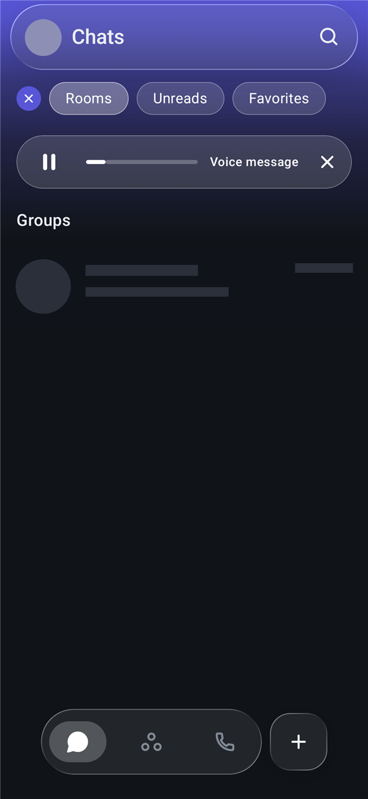|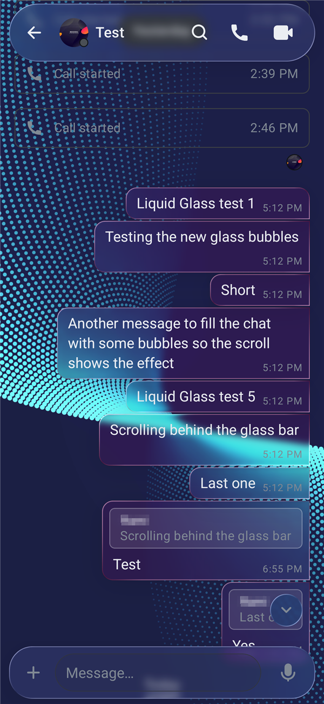|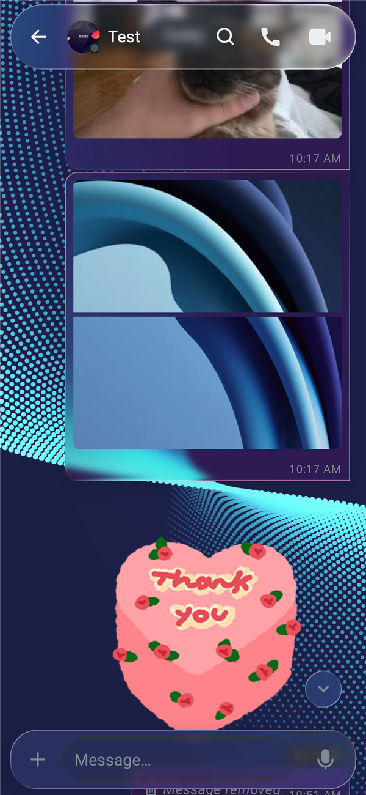|
|-|-|-|
|Liquid Glass header, glass chips and the voice message mini player|Liquid Glass chat with glass bubbles, reply quotes and message bar|Sticker without a bubble|

|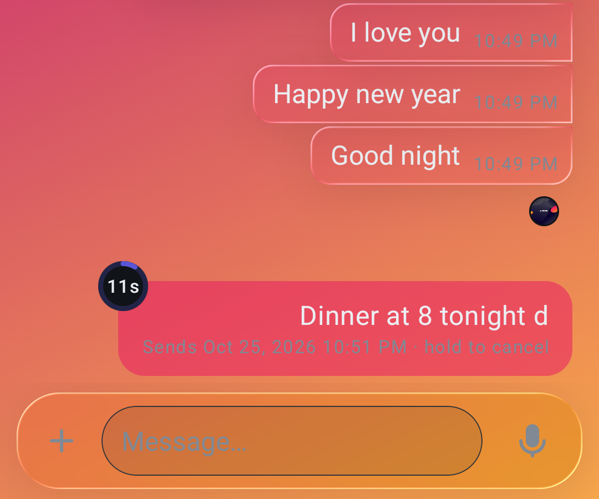|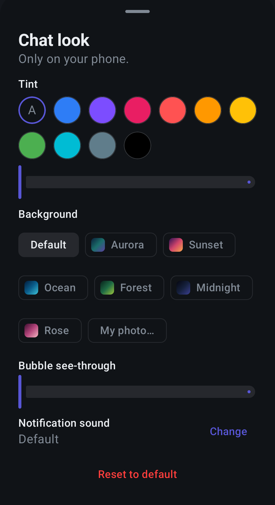|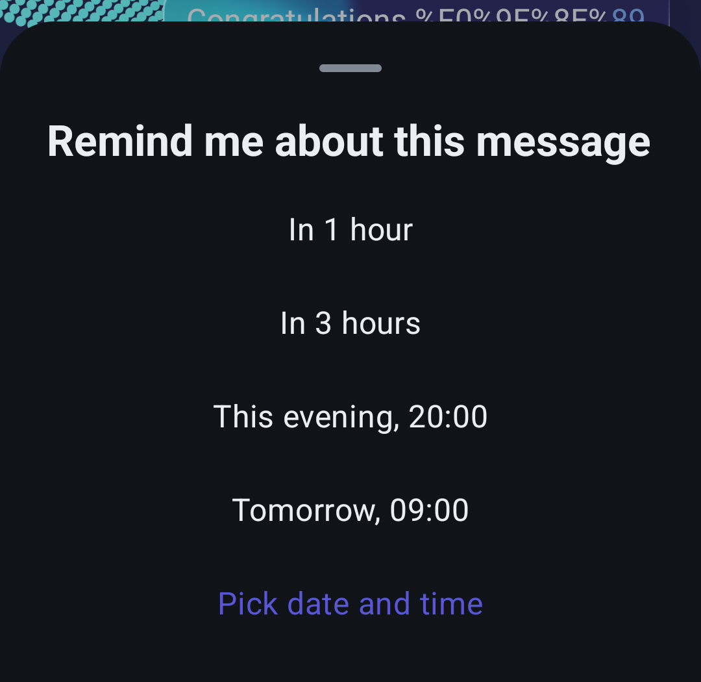|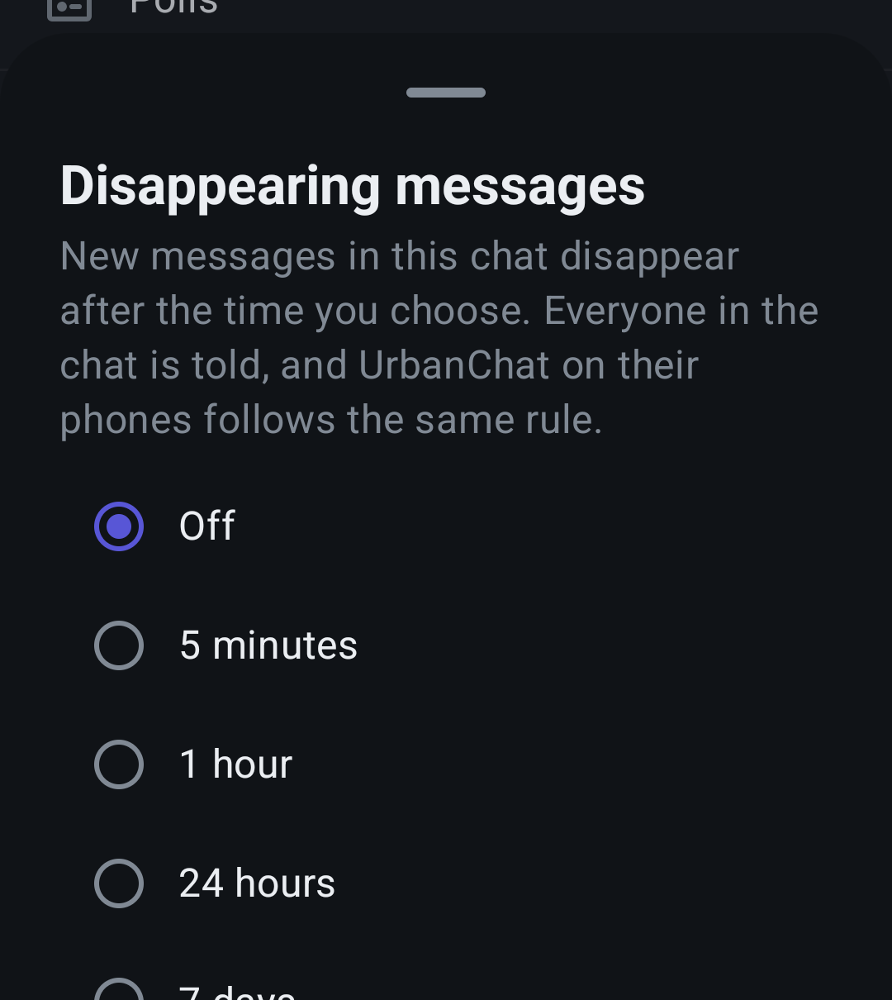|
|-|-|-|-|
|Chat look with a ready-made background and a scheduled message counting down|Chat look settings for one chat|Remind me about a message|Disappearing messages|

|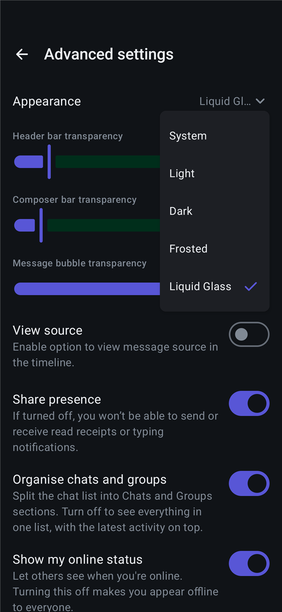|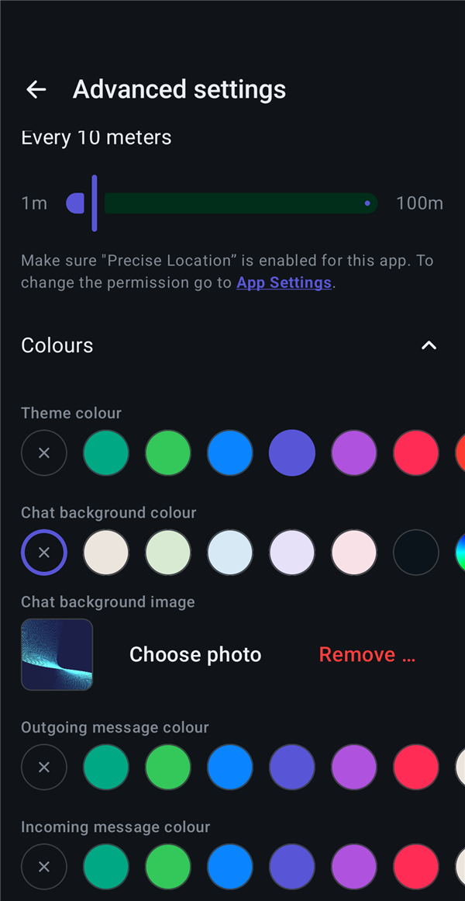|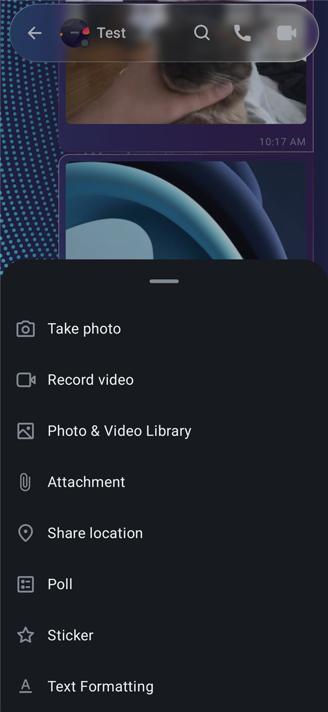|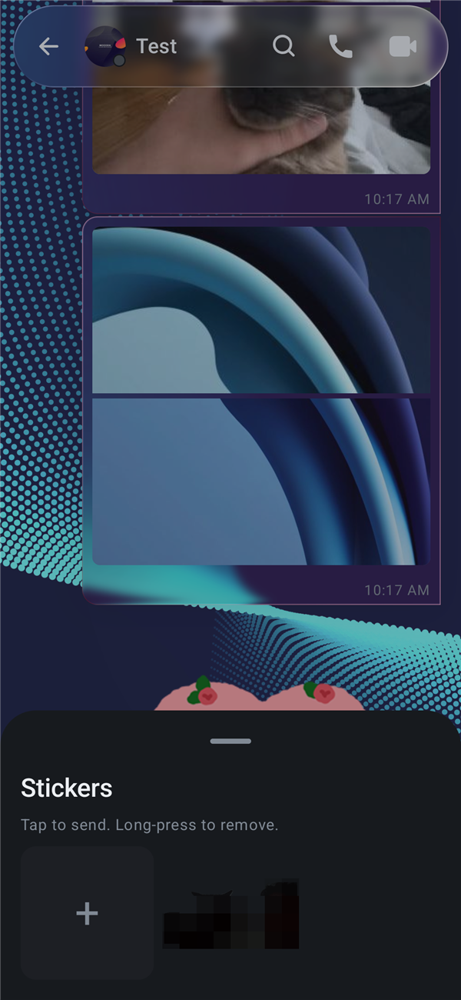|
|-|-|-|-|
|Appearance setting with the Liquid Glass option|Colours: theme, chat background and message colours|Attach menu with the new Sticker entry|Sticker tray|

The Frosted theme:

|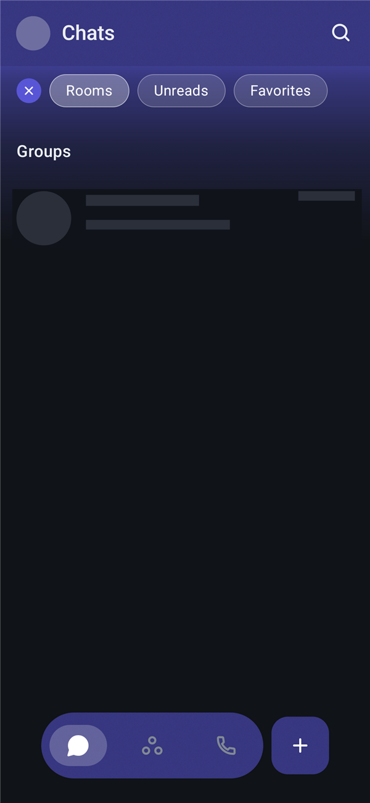|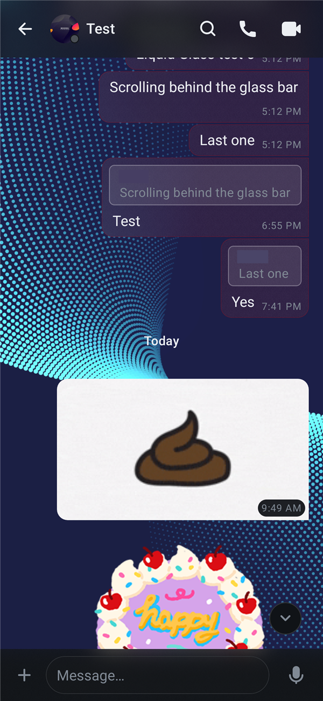|
|-|-|
|Frosted chat list with glass chips|Frosted chat with translucent bubbles and reply quotes|

## Rust SDK

UrbanChat leverages the [Matrix Rust SDK](https://github.com/matrix-org/matrix-rust-sdk) through an FFI layer that the client directly imports and uses, the same way Element X does.

## Minimum SDK version

UrbanChat requires a minimum SDK version of 24 (Android 7.0, Nougat).

## Build instructions

Just clone the project and open it in Android Studio. Make sure to select the
`app` configuration when building (as there are also sample apps in the project).

To build against a local copy of the Rust SDK, see the [Developer
onboarding](docs/_developer_onboarding.md#building-the-sdk-locally) instructions.

## Copyright and License

Copyright (c) 2026 UrbanTechIO.

UrbanChat is a derivative work of Element X Android:

Copyright (c) 2025 Element Creations Ltd.
Copyright (c) 2022 - 2025 New Vector Ltd.

This software is dual licensed by Element Creations Ltd (Element). It can be used either:

(1) for free under the terms of the GNU Affero General Public License (as published by the Free Software Foundation, either version 3 of the License, or (at your option) any later version); OR

(2) under the terms of a paid-for Element Commercial License agreement between you and Element (the terms of which may vary depending on what you and Element have agreed to).

Unless required by applicable law or agreed to in writing, software distributed under the Licenses is distributed on an "AS IS" BASIS, WITHOUT WARRANTIES OR CONDITIONS OF ANY KIND, either express or implied. See the Licenses for the specific language governing permissions and limitations under the Licenses.
